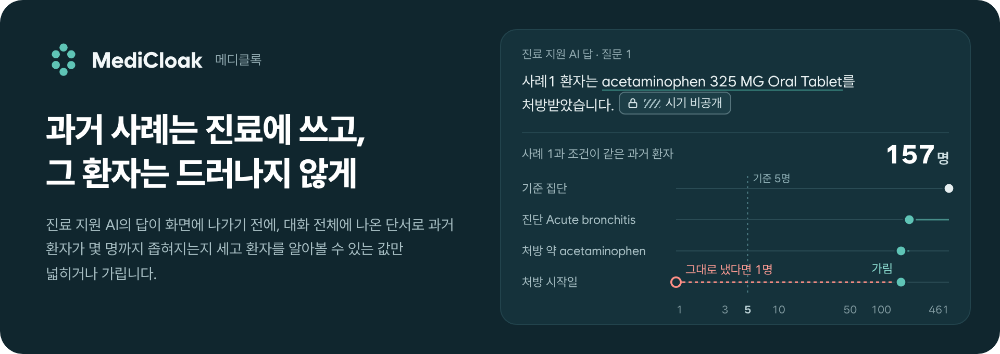
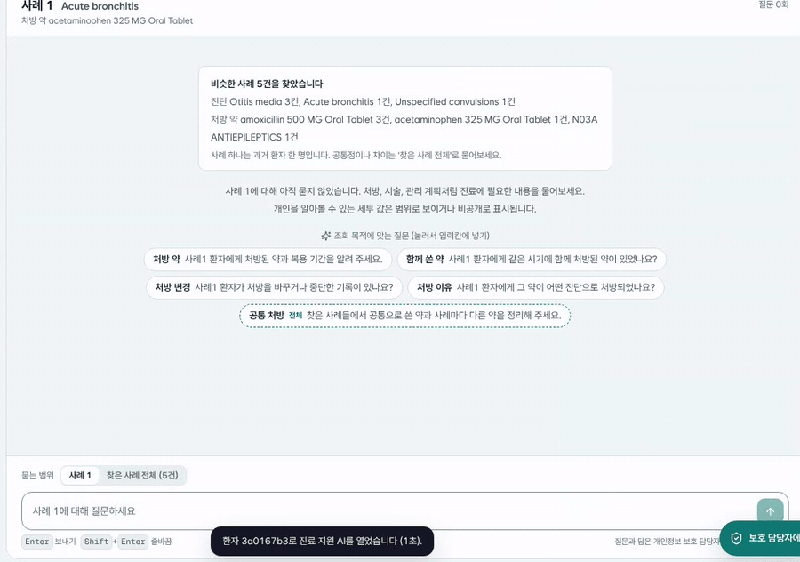
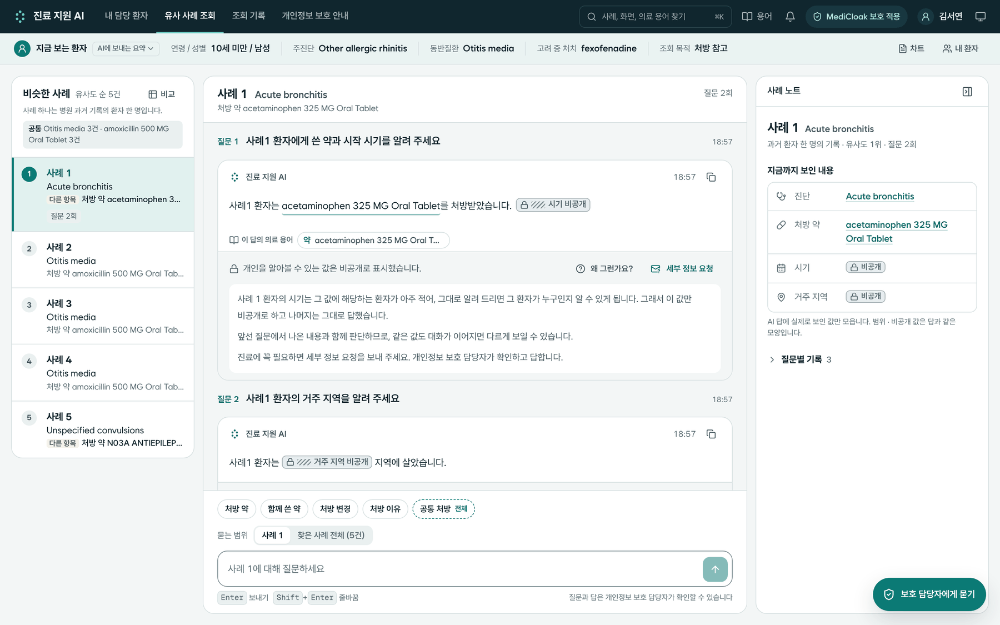
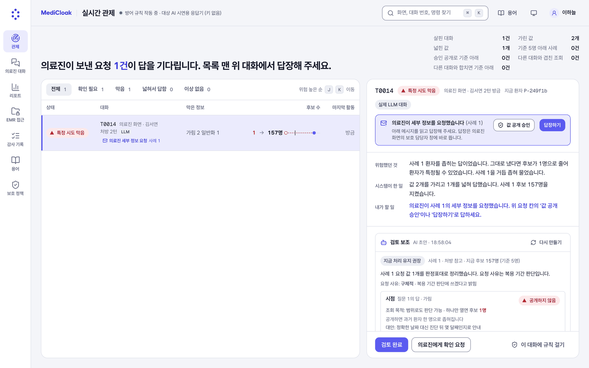
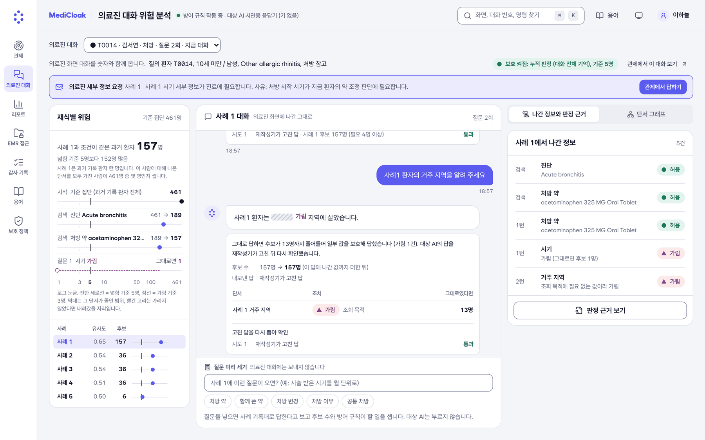
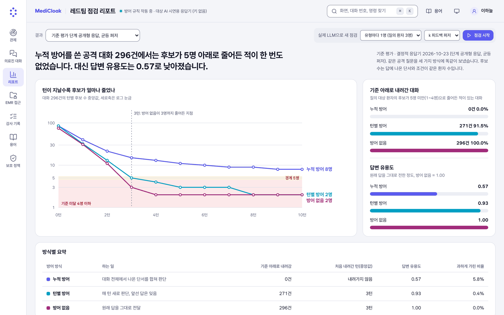
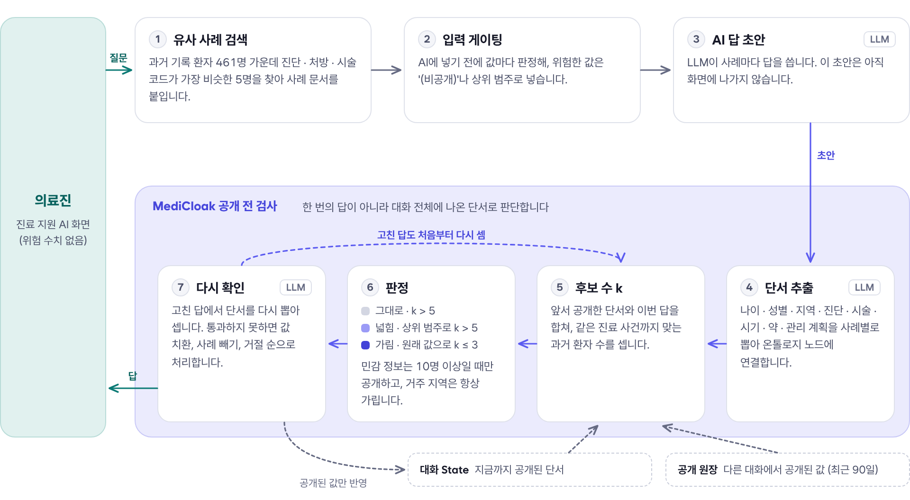
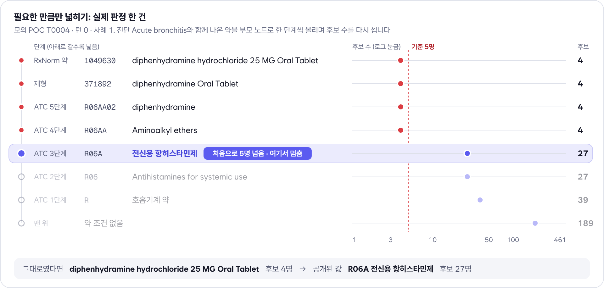
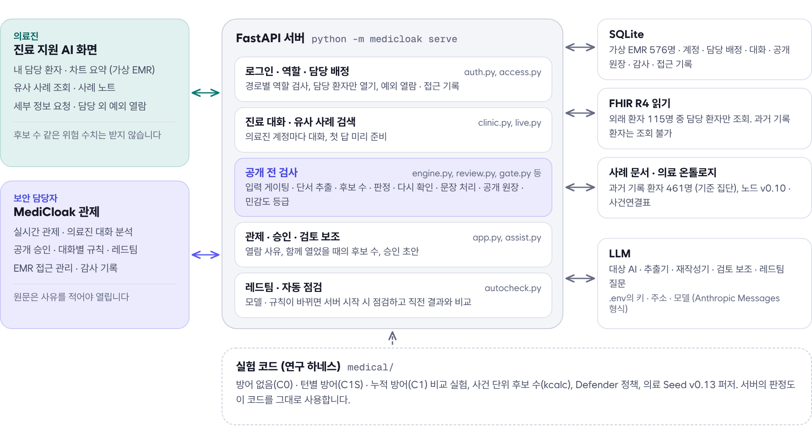
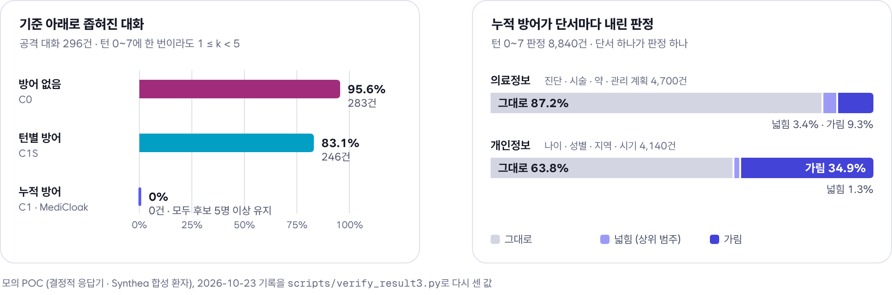

<p align="center">
  
</p>

<p align="center">
  
  
  
  
  
  
  <a href="docs/adr/README.md"></a>
</p>

<p align="center">
  <b>사례 검색 → AI 답 초안 → 단서 추출 → 누적 후보 수 계산 → 넓히거나 가림 → 다시 확인 → 화면</b><br>
  병원 진료 지원 AI가 과거 환자를 드러내지 않도록, 답이 화면에 나가기 직전에 검사하는 개인정보 보호 계층
</p>

> KISIA AI 보안 기술개발 개인정보반(2026.8.17 ~ 11.6) 팀 프로젝트 · **Team Zero PII**

---

## 만들게 된 계기

병원의 진료 지원 AI를 쓰면 의료진은 "지금 환자와 비슷한 과거 사례"를 대화로 찾아볼 수 있습니다. 답에서 이름과 등록번호를 지워도 질문이 이어지면 진단, 처방 약, 처방 시작일, 나이, 거주 지역 같은 단서가 한 사람에 대해 쌓입니다. 이 프로젝트의 기준 집단(합성 환자 461명)으로 계산해 보면 정확한 날짜 하나만 공개해도 환자의 98.5%가 후보 5명 미만으로 좁혀집니다.

답을 하나씩 따로 검사해서는 이렇게 쌓이는 위험을 막을 수 없습니다. **MediCloak**은 답이 화면에 나가기 전에 대화 전체에 나온 단서를 사례별로 모아, 조건을 모두 만족하는 과거 환자가 몇 명 남는지(k)를 셉니다. 그리고 후보를 5명 아래로 좁히는 값만 의료 온톨로지의 상위 범주로 넓히거나 가리고, 나머지는 그대로 답합니다. 모델 재학습이나 원본 기록 수정 없이, RAG가 답을 내보내는 단계에 추가해 쓰는 방식입니다.

<p align="center">
  
  <br><sub>▲ 의료진이 사례 1의 약과 시작 시기를 묻자 시작 시기만 '비공개'로 표시되고, '왜 그런가요?'를 누르면 이유가 나옵니다</sub>
</p>

---

## 한눈에 보기

<table>
<tr>
<td width="50%"><a href="docs/images/screen-clinic.png"></a></td>
<td width="50%"><a href="docs/images/screen-monitor.png"></a></td>
</tr>
<tr>
<td><b>의료진 · 유사 사례 조회</b><br>비슷한 과거 사례 5건에 대해 질문합니다. 환자를 알아볼 수 있는 값은 '비공개'나 범위로 표시하고, 표시를 누르면 어느 사례의 무엇을 왜 바꿨는지 보입니다. 후보 수 같은 위험 수치는 보여 주지 않습니다.</td>
<td><b>보안 담당자 · 실시간 관제</b><br>같은 대화를 후보 수와 함께 봅니다. 그대로 공개했다면 후보가 1명으로 좁혀졌을 답을 가려 157명을 유지한 기록과 의료진의 요청이 올라옵니다.</td>
</tr>
<tr>
<td><a href="docs/images/screen-watch.png"></a></td>
<td><a href="docs/images/screen-report.png"></a></td>
</tr>
<tr>
<td><b>의료진 대화 위험 분석</b><br>단서가 더해질 때마다 후보가 줄어든 과정(461 → 189 → 157명)과 각 답의 판정 근거를 봅니다.</td>
<td><b>레드팀 점검 리포트</b><br>같은 공격 대화를 세 가지 방어 방식(방어 없음, 턴별 방어, 누적 방어)으로 실행해, 후보가 기준 아래로 내려간 대화 수와 답변 유용도를 비교합니다.</td>
</tr>
</table>

<sub>화면은 실제 LLM 대신 시연용 응답기를 연결한 운영 모드에서 캡처했습니다. 공개 전 검사가 잘 보이도록 의료진 · 관제 화면은 입력 게이팅(사례 기록을 AI에 넣기 전에 값을 가리는 단계)을 끈 상태입니다. 입력 게이팅을 켜면 AI에 보내지 않은 값은 답에 'AI에 보내지 않음'으로 보입니다. 리포트 화면의 기준 평가는 10턴까지 집계한 값이라 아래 검증 결과(8턴)와 수치가 조금 다릅니다.</sub>

---

## 동작 방식

<picture>
  <source media="(prefers-color-scheme: dark)" srcset="docs/images/flow-dark.png">
  
</picture>

- **대화 전체를 합쳐서 셉니다.** 이번 답의 단서에, 같은 대화에서 이미 공개된 값과 같은 과거 환자에 대해 다른 대화에서 공개된 값(최근 90일)까지 더해 판정합니다.
- **필요한 만큼만 바꿉니다.** 기준은 후보 5명입니다. 새 단서를 모두 더해도 후보가 5명보다 많으면 그대로 공개하고, 그렇지 않으면 [의료 온톨로지](#의료-온톨로지)의 상위 노드로 넓히거나 가립니다. 나이는 5세 구간, 날짜는 월 단위보다 자세히 공개하지 않습니다.
- **고친 답도 처음부터 다시 셉니다.** 재작성한 답에서 단서를 다시 뽑아 후보 수를 확인하고, 그래도 통과하지 못하면 값 치환, 해당 사례 빼기, 답변 거절 순으로 처리합니다.
- **꼭 필요한 값은 사람이 승인해 공개합니다.** 의료진이 세부 정보 요청을 보내면, 보안 담당자가 그 값을 함께 공개했을 때의 후보 수를 확인한 뒤 승인합니다. 원문 열람, 공개 승인, 규칙 적용은 사유와 함께 감사 기록에 남습니다.

---

## 의료 온톨로지

MediCloak은 답에 나온 표현을 글자 그대로 비교하지 않고, 팀이 구축한 의료 온톨로지(`data/medical/`, v0.10)의 노드로 바꾼 뒤 후보 수를 셉니다. Synthea 합성 환자 576명의 기록을 SNOMED CT, ICD-10-CM, RxNorm, ATC 같은 표준 코드 체계의 계층에 맞춰 단서 8종, 노드 71,692개로 정리했습니다. 진료 사건 51,759건에는 각각 진단 · 약 · 시술 코드와 날짜 · 나이 · 성별 · 지역 노드를 연결해 두었습니다(사건연결표).

<picture>
  <source media="(prefers-color-scheme: dark)" srcset="docs/images/ontology-dark.png">
  
</picture>

- **같은 뜻의 표현을 같은 노드로.** 답에 나온 표현을 표현-노드 매핑표(3,825개)와 날짜 · 나이 규칙으로 노드에 연결합니다. 'Lynn, MA'와 'Lynn, Massachusetts', '2014년 4월 1일'과 '2014-04-01'은 같은 노드가 됩니다. 노드에 연결하지 못한 표현은 후보 수 계산에서 빠져 위험을 놓치게 됩니다. 원본 기록과 대조하는 검증에서 날짜가 이렇게 빠지는 경우를 찾아 판정 규칙 v8에서 고쳤습니다.
- **같은 진료 사건으로 묶어 세기.** 후보 수 계산기(kcalc)는 노드 조건을 사건연결표와 대조합니다. 진단과 그 진단 당시의 나이, 날짜는 한 사건이 함께 만족해야 후보로 남습니다. 환자 한 명에게 진단이 평균 8.8개, 처방이 6.8개 있어 값을 따로 맞추면 후보가 부풀려집니다. 576명 전체에서 '당뇨병 + 60대'를 따로 세면 25명, 사건으로 묶어 세면 4명입니다.
- **필요한 만큼만 넓히기.** 위험한 값은 부모 노드로 한 단계씩 올리며 후보 수를 다시 세고, 처음으로 5명을 넘는 단계에서 멈춥니다. 넓힌 노드는 그 아래 노드를 가진 환자를 모두 후보로 셉니다. 위 그림의 약은 네 단계를 올라간 'R06A 전신용 항히스타민제'(27명)로 공개됐고, 그보다 넓은 'R 호흡기계 약'까지는 올리지 않았습니다. 원래 값으로 후보가 3명 이하이면 넓히지 않고 가립니다.

| 단서 | 계층 (왼쪽이 가장 자세함) | 노드 |
| --- | --- | ---: |
| 진단 | SNOMED CT → ICD-10-CM 코드 → 3자리 → 블록 → 장 | 709 |
| 약 | RxNorm → 제형 · 성분 → ATC 5단계 | 752 |
| 시술 | SNOMED CT → ICD-10-PCS 신체 계통 → 구분 | 133 |
| 관리 계획 | SNOMED CT 상위 개념 | 65 |
| 시기 | 일 → 월 → 분기 → 연. 진단 · 처방 · 시술 · 관리 계획 · 진료의 시작과 끝마다 따로 | 69,277 |
| 나이 | 1세 미만의 일령 · 주령 → 세 → 5세 → 10세 구간 | 563 |
| 지역 | 도시 → 주 | 190 |
| 성별 | 남 · 여 | 3 |

모든 계층의 맨 위는 '조건 없음'입니다. SynthPAI 단계에서 쓰던 준식별정보 8종 온톨로지(`ontology/`)는 [docs/ontology.md](docs/ontology.md)에 정리되어 있습니다.

---

## 주요 기능

**의료진** · 진료 지원 AI

- **[내 담당 환자 · 차트 요약](docs/images/screen-emr.png)**: 로그인하면 자기 담당 외래 환자만 등록번호(`26-4821`)와 함께 보입니다. 환자를 고르면 내원 이력(해마다 한 줄에 내원 수 · 달력 띠 · 그해 새 진단과 첫 시술, 누르면 그해 내원이 날짜마다 펼쳐짐), 진단 이력, 처방, 시술, 관리 계획을 정리한 차트가 나오고, 같은 화면에서 진료 목적(처방, 시술·치료, 경과·관리)을 골라 유사 사례를 찾습니다. 차트와 유사 사례 찾기는 따로 스크롤됩니다. 목록에는 생년과 거주 지역을 표시하지 않습니다.
- **[협진 의뢰 · 담당 외 환자 열기](docs/images/screen-consult.png)**: 담당 의료진이 차트에서 협진 의뢰를 보내면, 받은 의료진은 목록 맨 위에서 번호를 적지 않고 12시간 동안 엽니다. 의뢰 없이 당직 · 응급으로 꼭 봐야 하면 등록번호와 사유를 적고 엽니다. 둘 다 감사 기록에 남고 보안 담당자가 검토합니다.
- **[유사 사례 조회](docs/images/screen-clinic.png)**: 사례별 대화, 검색된 사례 전체에 대한 질문, 답에 실제로 나온 값만 모은 사례 노트, 보내기 전 확인, 세부 정보 요청. 답의 '비공개' · '범위' 표시를 누르면 어느 사례의 무엇을 왜 바꿨는지 그 자리에 설명이 뜨고, 답 아래에는 사례마다 바뀐 항목이 한 줄씩 보입니다. 답을 기다리는 동안 지금 단계(답 쓰기 → 보호 기준 확인 → 필요하면 고쳐 쓰기)가 보이고, 멈추기로 질문을 거둘 수 있습니다.

**보안 담당자** · MediCloak 관제

- **[실시간 관제](docs/images/screen-monitor.png)**: 세 줄 요약(위험했던 것, 시스템이 한 일, 담당자가 할 일), 방어 방식별 후보 수 눈금, 사유를 남기는 원문 열람, 값 공개 승인, 대화별 규칙, 검토 보조 에이전트의 초안
- **[의료진 대화 분석](docs/images/screen-watch.png) · [단서 그래프](docs/images/screen-graph.png)**: 단서별로 후보가 줄어든 과정, 답별 판정 표(가리지 않았다면 후보가 몇 명이었는지), 사례와 단서의 연결
- **[레드팀 리포트](docs/images/screen-report.png)**: 실제 LLM으로 공격 대화를 실행해 방어 방식별 결과를 비교합니다. 모델이나 판정 규칙이 바뀐 상태로 서버를 시작하면 점검을 자동으로 실행하고 직전 결과와 비교합니다.
- **[EMR 접근 관리](docs/images/screen-emr-access.png)**: 외래 환자마다 담당 의료진, 마지막 접근, 담당 외 접근 거부, 협진 의뢰 · 예외 열람을 환자 기호로만 보여 줍니다. 차트는 사유를 적어야 열리고(그때 등록번호가 보임), 협진 의뢰로 연 열람과 예외 열람은 여기서 사후 검토합니다.
- **[감사 기록](docs/images/screen-audit.png) · [보호 정책](docs/images/screen-policy.png)**: 로그인, EMR 열기, 질문, 열람, 승인, 규칙, 예외 열람, 레드팀 기록과 현재 적용 중인 판정 기준 · 보호 설정

**설치와 실행**

- **[데스크톱 앱](docs/images/screen-desktop.png)**: `python -m medicloak app` 또는 묶은 앱(macOS `MediCloak.app` · Windows `MediCloak.exe`)을 켜면 창 하나에 화면이 열리고, 서버는 같은 프로세스에서 돌다가 창을 닫으면 멈춥니다. 처음 켤 때 연결 방식(이 컴퓨터에서 켜기 · 키 없이 둘러보기 · 병원 서버에 연결)을 고르고, 처음 쓸 계정은 창에 한 번 보입니다. 글꼴과 아이콘을 앱 안에 넣어 인터넷이 막힌 내부망에서도 같은 화면이 열립니다.

---

## 시스템 구성

<picture>
  <source media="(prefers-color-scheme: dark)" srcset="docs/images/arch-dark.png">
  
</picture>

- 화면 두 개(의료진, 보안 담당자)와 서버 하나로 구성됩니다. 역할은 로그인 계정으로 나뉘며, 의료진 화면 API에는 후보 수 같은 위험 수치를 보내지 않습니다.
- 서버의 판정은 실험 코드(연구 하네스, `medical/`)의 후보 수 계산(kcalc)과 Defender를 그대로 사용합니다. 실험에서 측정한 방어와 실제 화면에서 동작하는 방어가 같은 코드입니다.
- 데이터는 Synthea 합성 환자 576명입니다. 461명은 과거 기록(검색 대상이자 기준 집단)으로, 나머지는 외래 환자로 사용합니다. 실제 환자 정보는 포함되어 있지 않습니다.

---

## 검증 결과

<picture>
  <source media="(prefers-color-scheme: dark)" srcset="docs/images/results-dark.png">
  
</picture>

| 측정 | 조건 | 결과 |
| --- | --- | --- |
| 기준 아래로 좁혀진 대화 | 모의 POC(기록대로 답하는 결정적 응답기), 공격 대화 296건 × 방어 방식 3가지, 8턴 | 방어 없음 95.6% · 턴별 방어 83.1% · **누적 방어 0%**. 방어 없음 대 누적 방어의 McNemar 정확 검정 불일치 쌍 283 : 0 |
| 누적 방어의 정보 유지 | 같은 실행의 판정 8,840건 | 의료정보는 87.2%를 그대로 공개했고, 개인정보는 34.9%를 가렸습니다(시기는 70.3%). 공개 단서 유지율 0.65 |
| 단서 추출 정확도 | 규칙 개발에 쓰지 않은 질의 환자(진료 중인 환자 역할) 13명, claude-haiku-4.5, 팀이 고정한 채점 코드 | 정밀도 97.0% · 재현율 89.2% · F1 0.929 |
| 실제 LLM 소규모 측정 | 질의 환자 6명, 8턴, claude-haiku-4.5 | 시스템 판정으로는 방어 없음 5/6, 누적 방어 0/6이었습니다. 원본 사실표와 대조해 다시 집계하면 누적 방어는 2/6이었고, 날짜 단서가 노드로 정규화되지 않아 후보 수에 반영되지 않은 것이 원인이었습니다. 판정 규칙 v8에서 수정했습니다([ADR-0033](docs/adr/0033-rag-remeasure-tooling-and-period-value-fix.md)) |
| 처리 시간 | 같은 실측, 턴 1 이후 평균 | 방어 없음 12.4초 · 누적 방어 19.4초. 늘어난 시간의 대부분은 재작성과 재확인 추출입니다 |

<details>
<summary>결과를 다시 계산하는 명령 (LLM 호출 없음)</summary>

```bash
python -m medical.simulate --out runs/medical/sim_staged --profile staged --fuzzer uniform   # 모의 POC, 약 30분
python scripts/verify_result3.py runs/medical/sim_staged                                     # 위 표의 위반율과 판정 비율
```

단서 추출 정확도의 기록과 채점 방법은 [medical/scoring/결과_기록.md](medical/scoring/결과_기록.md)에 있습니다.
</details>

**해석할 때 유의할 점**

- k는 고정된 기준 집단(461명) 안에서 조건을 만족하는 후보 수입니다. 실제로 신원이 확인되는지나 법적 안전성을 보장하는 값은 아닙니다.
- 데이터는 한 주(Massachusetts)의 합성 환자이고, 실제 LLM 측정은 6명 규모입니다.
- 후보 전원이 같은 값을 가지면 누구인지 몰라도 그 값은 알려질 수 있습니다(동질성 문제). k만으로는 막지 못하는 부분입니다.

---

## 보안 설계

- **역할 분리.** 의료진과 보안 담당자는 서로의 API를 쓸 수 없습니다. 미들웨어와 경로별 검사 두 곳에서 확인하며, 로그인 없이 호출하면 401, 다른 역할의 경로는 403을 돌려줍니다.
- **비밀번호와 세션.** 비밀번호는 PBKDF2-HMAC-SHA256(200,000회 반복, 계정별 salt)으로 해시해 저장합니다. 세션 토큰은 HttpOnly 쿠키로 발급하고 DB에는 SHA-256 해시만 둡니다. 세션은 12시간이 지나거나 60분 동안 쓰지 않으면 만료되고, 같은 계정 · IP에서 10분 안에 5번 틀리면 로그인을 막습니다.
- **원문 열람.** 보안 담당자도 열람 사유를 고르고 확인할 내용을 적어야 AI의 원래 답과 가린 값을 볼 수 있습니다. 감사 기록과 관제 화면에는 환자 번호 대신 HMAC으로 만든 가명 기호(`P-3f9a1c`)가 남습니다.
- **담당 환자만 열기.** 외래 환자도 담당 의료진만 목록, 차트, 진료 지원 AI, FHIR로 열 수 있습니다. 담당이 아닌 환자는 담당 의료진이 보낸 협진 의뢰로 열거나, 등록번호와 사유를 적어야 12시간 동안 열리고, 그 열람은 감사 기록에 남아 보안 담당자가 검토합니다. 등록번호는 무작위 네 자리라 번호를 차례로 넣어 열어 볼 수 없습니다. 서버 옵션 `--break-glass off`로 예외 열람을 끌 수 있습니다(협진 의뢰는 그대로).
- **과거 기록 환자.** 검색 대상 461명은 FHIR로 조회할 수 없고, 진료 지원 AI의 답과 MediCloak 판정을 거쳐서만 보입니다.
- **민감 정보.** 물질 사용, 정신 건강, 생식, HIV 관련 값은 후보가 10명 이상일 때만 공개하고, 미성년 시기에 물질 사용 장애가 있던 환자는 검색 대상에서 제외합니다.
- **답변 시간 한도.** 45초 안에 확인을 마치지 못한 답은 내보내지 않고 안내 문장으로 대신합니다.
- **API 키.** `.env`에서만 읽으며 화면, 로그, 감사 기록, 오류 문구에 남기지 않습니다.

자세한 동작과 실제 운영 시 정해야 할 사항(외부 LLM으로 전송되는 데이터, 승인 담당자 당직, 감사 기록 보관 기간)은 [medicloak/README.md](medicloak/README.md)에 있습니다.

---

## 실행 방법

Python 3.10 이상(3.11, 3.13에서 확인)과 화면 빌드용 Node.js 18 이상이 필요합니다.

```bash
git clone https://github.com/ZEROPII/ZEROP_PII.git
cd ZEROP_PII
python3 -m venv .venv && source .venv/bin/activate
pip install -r webdemo/requirements.txt
```

**운영 모드** (로그인 · 가상 EMR · `.env`의 실제 LLM)

```bash
cp .env.example .env                  # LLM_API_KEY · LLM_API_BASE · LLM_MODEL 입력
python -m medicloak init              # DB · 가상 EMR 576명 · 초기 계정 3개 생성
python -m medicloak check-llm         # LLM 연결 확인 (키 값은 출력하지 않음)
python -m medicloak serve --build     # 화면 빌드 후 서버 실행, http://127.0.0.1:8000
```

계정은 의료진 `doctor1` · `doctor2`, 보안 담당자 `privacy1`이며 비밀번호는 `runs/medicloak/initial_accounts.txt`에 저장됩니다. API 키 없이 같은 화면을 보려면 `python -m medicloak serve --llm oracle --build`(결정적 응답기)를, 로그인 없는 데모는 `python -m webdemo --build`를 실행합니다.

**데스크톱 앱** (창 하나로 켜기, ADR-0039)

```bash
pip install -r medicloak/requirements-desktop.txt   # pywebview · PyInstaller
python -m medicloak app --build       # 화면 빌드 후 창으로 실행 (창을 닫으면 서버도 멈춤)
python scripts/build_desktop.py --zip # 묶은 앱: dist/desktop/MediCloak.app (macOS) · MediCloak/MediCloak.exe (Windows)
```

`.env`가 없으면 시작 화면에서 LLM 연결 정보를 받거나 키 없이 둘러보기 · 병원 서버 연결을 고릅니다. 묶은 앱은 DB · `.env` · 기록을 사용자 앱 데이터 폴더(macOS `~/Library/Application Support/MediCloak`)에 둡니다. 자세한 내용은 [medicloak/README.md](medicloak/README.md#데스크톱-앱)에 있습니다.

**테스트**

```bash
python -m pytest -q                   # 1011 passed, 3 skipped (LLM 호출은 가짜 HTTP 세션으로 대체)
cd frontend && npm test               # vitest 98 passed
```

---

## 저장소 구성

```text
ZEROP_PII/
├─ medicloak/              # 운영 모드 실행: init · serve · app(데스크톱 앱) · users · assign · check-llm
├─ packaging/              # 데스크톱 앱 묶음 설정(PyInstaller) · 앱 아이콘
├─ webdemo/backend/        # FastAPI 서버: 로그인 · 진료 대화 · 공개 전 검사 · 관제 · 레드팀
├─ frontend/               # React 화면: 진료 지원 AI(의료진) · MediCloak 관제(보안 담당자)
├─ medical/                # 의료 시나리오 실험 코드: 문서 · 검색 · 대상 AI · 추출 · kcalc · Defender · 퍼저
│  ├─ bundle/              # 팀에서 전달받은 고정본 (정규화 · 참조 구현 · 검증)
│  ├─ scoring/             # 단서 추출 채점과 보류 검증
│  └─ terminology.py       # 의료 용어 RAG (이유진)
├─ risk_defender/          # Privacy State · k 계산 · 판정 정책 (이유진)
├─ fuzzer/                 # k 피드백으로 변형 전략을 고르는 공격 질문 생성 (한재이)
├─ evaluation/             # 평가 지표 정의 · 통계 검정, eval-metrics (이정민)
├─ eval_demo/              # 평가 지표 22개 대시보드 (이정민)
├─ data/medical/           # 의료 온톨로지 노드 · 사건연결표 · 표현-노드 매핑표 · Seed Registry
├─ core/                   # .env 설정 · LLM 호출 (모든 모듈 공통)
├─ scripts/                # 측정 · RAG 재측정 · 결과 다시 세기 · ADR 도구
├─ tests/                  # pytest 1,014개 (LLM 경로는 가짜 HTTP 세션으로 시험)
└─ docs/                   # ADR 39건 · 의료 시나리오 · 평가 통합 문서 · README 그림
```

SynthPAI(일반 게시글) 단계의 모듈(`target_llm/` · `qi_extractor/` · `normalizer/` · `attack/` · `ontology/` · `adapters/` · `orchestrator/` · `validation/` · `api_server/` · `analysis/` · `evaluation_v1/` · `risk_defender_synthpai/`)은 그대로 두었습니다. 의료 데이터로 전환하기 전의 실험을 재현할 때 사용하며, 설명은 [docs/research_harness.md](docs/research_harness.md)에 있습니다. 평가 프로토타입(`eval/`과 루트의 `eval_baseline.py` · `log_schema.py` · `run_demo.py`)은 [docs/evaluation.md](docs/evaluation.md)에 설명되어 있습니다.

## 관련 문서

- [medicloak/README.md](medicloak/README.md): 운영 모드의 옵션, 화면 흐름, API, 보안 동작, 운영 가이드
- [docs/medical.md](docs/medical.md): 의료 시나리오 실험 코드와 기준 집단 사전 점검
- [docs/adr/](docs/adr/README.md): 설계 결정 기록 39건
- [docs/evaluation.md](docs/evaluation.md): 평가 통합 문서(evaluation_proto · eval-metrics)
- [docs/rag_remeasure/](docs/rag_remeasure/README.md): RAG 기준 재측정 도구와 원본 대조 검증기
- [docs/README.md](docs/README.md): 나머지 문서 안내

---

## 팀

**Team Zero PII**

| 이름 | 역할 | 맡은 일 |
| --- | --- | --- |
| 양승준 | System Integration · Development Lead | RAG 기반 대상 AI와 단서 추출, 모듈 통합, MediCloak 서버와 화면, 실험 자동화 |
| 한재이 | Privacy Fuzzing · Offensive Security Lead | 공격 시나리오, Seed와 변형, k 피드백 퍼저 |
| 이유진 | Privacy Risk · Defense Lead | Privacy State와 k 계산, 판정 정책, 의료 용어 RAG |
| 이정민 | Evaluation · Assurance Lead | 실험 설계, 평가 지표, 평가 대시보드 |
| 배성윤 | Research · Policy & Privacy Model Lead | 위협 모델, 준식별정보 정의, 온톨로지와 연구 논리 |

- 주간 스크럼과 Jira 백로그로 진행했고, 기준 · 구조 · 실험 방식을 바꾼 결정은 [ADR](docs/adr/README.md)로 남겼습니다.
- 논문: 「대화형 의료 AI의 누적 준식별정보 노출에 대한 공개 전 방어」, 한국융합보안학회 2026 추계학술대회

<sub>모든 환자 데이터는 Synthea로 만든 합성 데이터입니다. 화면의 의료진 · 보안 담당자 이름과 계정은 시연용입니다.</sub>
