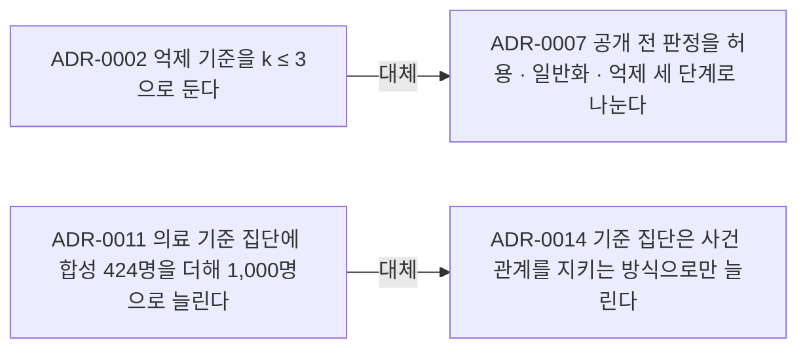
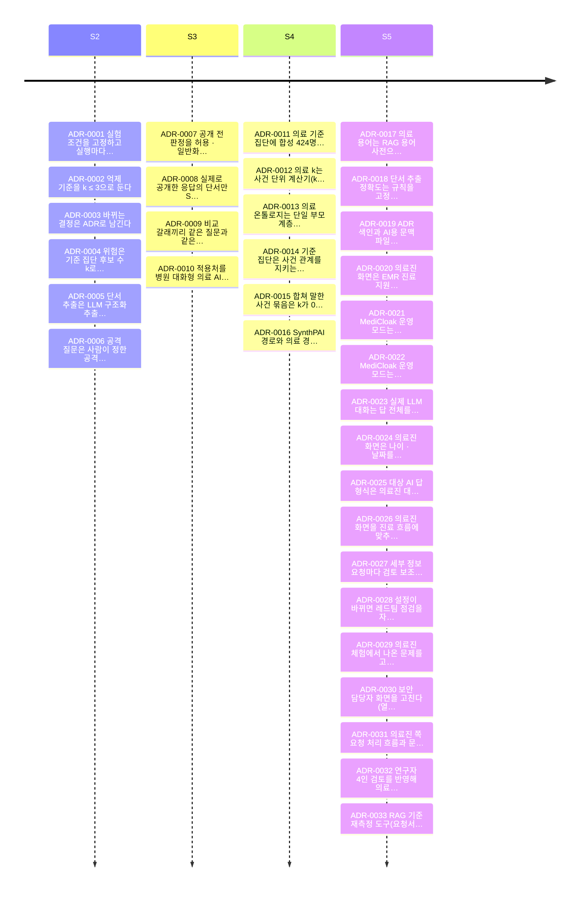

# 의사결정 기록 (ADR)

> 이 파일은 `python scripts/adr.py index`가 만든다. 표를 직접 고치지 말고 ADR 파일을 고친다.
> 병합되면 GitHub Actions가 다시 만들어 커밋한다.

아키텍처 · 기술 선택 · 실험 기준 · 트러블슈팅 중에서 나중에 "왜 이렇게 했지?"를 다시 찾게 될 결정을 한 건씩 남긴다.
형식과 운영 규칙은 [ADR-0003](0003-record-decisions-as-adr.md), 자동화는 [ADR-0019](0019-automate-adr-index-and-ai-context.md)에 있다.

## 쓰는 법

```bash
python scripts/adr.py new "제목" --slug short-name --deciders 이름 --area risk --sprint S5 --jira ZP-00
python scripts/adr.py supersede 0002 --by 0007   # 결정을 뒤집을 때: 새 ADR을 쓰고 옛 ADR은 '대체됨'
python scripts/adr.py lint                        # PR 전에 형식 검사
python scripts/adr.py index                       # 이 색인과 AI용 파일을 다시 만듦 (선택)
```

- 결정 하나에 파일 하나. 이미 승인된 ADR의 결정 내용은 고치지 않고 새 ADR로 대체한다.
- PR 설명에 ADR 번호를, Jira 스토리에는 ADR 번호와 링크를 남긴다.
- 외부 문서 근거는 `sources`에 `ext:`로 적는다. 저장소 경로는 lint가 존재 여부를 확인한다.

## 현황

전체 33건.

| 상태 | 건수 |
| --- | ---: |
| 승인 | 31 |
| 대체됨 | 2 |

| 영역 | 건수 |
| --- | ---: |
| 운영·협업 | 2 |
| 위험 측정·방어 | 5 |
| 단서 추출·정규화 | 2 |
| 공격 질문 생성 | 1 |
| 데이터·적용처 | 4 |
| 실험·검증 | 4 |
| 시스템·화면 | 15 |

| 스프린트 | 건수 |
| --- | ---: |
| S2 | 6 |
| S3 | 4 |
| S4 | 6 |
| S5 | 17 |

## 목록

| 번호 | 제목 | 상태 | 날짜 | 결정 | 스프린트 | 영역 | Jira |
| --- | --- | --- | --- | --- | --- | --- | --- |
| [ADR-0001](0001-fix-experiment-conditions.md) | 실험 조건을 고정하고 실행마다 설정을 기록한다 | 승인 | 2026-09-20 | 이정민, 양승준 | S2 | 실험·검증 | ZP-12 |
| [ADR-0002](0002-suppress-threshold-three.md) | 억제 기준을 k ≤ 3으로 둔다 | 대체됨 → ADR-0007 | 2026-09-23 | 이유진 | S2 | 위험 측정·방어 | ZP-11 |
| [ADR-0003](0003-record-decisions-as-adr.md) | 바뀌는 결정은 ADR로 남긴다 | 승인 | 2026-09-24 | 배성윤, 이유진, 이정민, 한재이, 양승준 | S2 | 운영·협업 | - |
| [ADR-0004](0004-candidate-count-k-as-risk.md) | 위험은 기준 집단 후보 수 k로 재고, 1 ≤ k < 5를 위반으로 본다 | 승인 | 2026-09-24 | 배성윤, 이유진 | S2 | 위험 측정·방어 | ZP-13 |
| [ADR-0005](0005-llm-structured-extractor.md) | 단서 추출은 LLM 구조화 추출기로 하고 근거 문구를 반드시 붙인다 | 승인 | 2026-09-24 | 양승준 | S2 | 단서 추출·정규화 | ZP-6 |
| [ADR-0006](0006-controlled-privacy-fuzzer.md) | 공격 질문은 사람이 정한 공격 공간 안에서만 LLM이 변형한다 | 승인 | 2026-09-24 | 한재이 | S2 | 공격 질문 생성 | ZP-10 |
| [ADR-0007](0007-three-level-release-decision.md) | 공개 전 판정을 허용 · 일반화 · 억제 세 단계로 나눈다 | 승인 | 2026-10-04 | 이유진 | S3 | 위험 측정·방어 | ZP-18 |
| [ADR-0008](0008-commit-only-released-response.md) | 실제로 공개한 응답의 단서만 State에 반영한다 | 승인 | 2026-10-05 | 양승준, 이유진 | S3 | 위험 측정·방어 | ZP-21 |
| [ADR-0009](0009-paired-branches-share-raw-response.md) | 비교 갈래끼리 같은 질문과 같은 원 응답을 쓴다 (--paired) | 승인 | 2026-10-06 | 양승준 | S3 | 실험·검증 | ZP-22 |
| [ADR-0010](0010-switch-to-medical-conversational-ai.md) | 적용처를 병원 대화형 의료 AI(유사 환자 조회)로 바꾼다 | 승인 | 2026-10-09 | 배성윤, 이유진, 이정민, 한재이, 양승준 | S3 | 데이터·적용처 | ZP-25, ZP-26, ZP-27, ZP-28, ZP-29, ZP-30, ZP-31 |
| [ADR-0011](0011-expand-population-to-1000.md) | 의료 기준 집단에 합성 424명을 더해 1,000명으로 늘린다 | 대체됨 → ADR-0014 | 2026-10-12 | 이유진 | S4 | 데이터·적용처 | - |
| [ADR-0012](0012-event-level-kcalc.md) | 의료 k는 사건 단위 계산기(kcalc) 하나로 센다 | 승인 | 2026-10-19 | 이유진, 양승준 | S4 | 위험 측정·방어 | ZP-28 |
| [ADR-0013](0013-single-parent-medical-ontology.md) | 의료 온톨로지는 단일 부모 계층으로 먼저 구현한다 | 승인 | 2026-10-19 | 양승준, 배성윤 | S4 | 데이터·적용처 | ZP-27 |
| [ADR-0014](0014-grow-population-keeping-event-links.md) | 기준 집단은 사건 관계를 지키는 방식으로만 늘린다 | 승인 | 2026-10-19 | 양승준, 이유진 | S4 | 데이터·적용처 | ZP-28 |
| [ADR-0015](0015-split-merged-event-bundles.md) | 합쳐 말한 사건 묶음은 k가 0이 되는 지점에서 나눈다 | 승인 | 2026-10-19 | 양승준 | S4 | 단서 추출·정규화 | ZP-29 |
| [ADR-0016](0016-separate-synthpai-and-medical-paths.md) | SynthPAI 경로와 의료 경로를 코드와 실행 명령에서 나눈다 | 승인 | 2026-10-23 | 양승준 | S4 | 시스템·화면 | ZP-29 |
| [ADR-0017](0017-medical-terminology-rag.md) | 의료 용어는 RAG 용어 사전으로 설명하고 화면 세 곳에 붙인다 | 승인 | 2026-10-28 | 이유진, 양승준 | S5 | 시스템·화면 | ZP-37, ZP-42 |
| [ADR-0018](0018-holdout-validation-for-extraction.md) | 단서 추출 정확도는 규칙을 고정한 뒤 처음 보는 환자로 검증한다 | 승인 | 2026-10-30 | 양승준, 이정민 | S5 | 실험·검증 | ZP-41 |
| [ADR-0019](0019-automate-adr-index-and-ai-context.md) | ADR 색인과 AI용 문맥 파일을 스크립트와 CI로 자동 생성한다 | 승인 | 2026-11-03 | 양승준 | S5 | 운영·협업 | ZP-42 |
| [ADR-0020](0020-clinician-emr-ui-security-console.md) | 의료진 화면은 EMR 진료 지원 AI로 두고 위험 분석은 보안 담당자 화면으로 옮긴다 | 승인 | 2026-11-04 | 양승준 | S5 | 시스템·화면 | - |
| [ADR-0021](0021-medicloak-production-mode.md) | MediCloak 운영 모드는 로그인 · 역할 분리 · DB 가상 EMR · 실제 LLM으로 데모 서버를 켠다 | 승인 | 2026-11-04 | 양승준 | S5 | 시스템·화면 | - |
| [ADR-0022](0022-medicloak-real-llm-everywhere-and-review-feedback.md) | MediCloak 운영 모드는 첫 답과 레드팀까지 실제 LLM으로 돌리고, 보안 담당자 검토를 규칙 · 공개 승인으로 대화에 반영한다 | 승인 | 2026-11-04 | 양승준 | S5 | 시스템·화면 | - |
| [ADR-0023](0023-medicloak-drop-failing-case-before-refusal.md) | 실제 LLM 대화는 답 전체를 거절하기 전에 통과하지 못한 사례만 빼고, 다시 고칠 때 재작성기에 남은 표현을 알려 준다 | 승인 | 2026-11-05 | 양승준 | S5 | 시스템·화면 | - |
| [ADR-0024](0024-medicloak-release-units-and-clinician-screen.md) | 의료진 화면은 나이 · 날짜를 정해진 공개 단위로만 내고, 사례 노트는 내보낸 답에 나온 값만 적는다. 외래 목록은 연령대와 진료 상태만 보인다 | 승인 | 2026-11-05 | 양승준 | S5 | 시스템·화면 | - |
| [ADR-0025](0025-medicloak-same-answer-style-for-clinic-and-redteam.md) | 대상 AI 답 형식은 의료진 대화와 실제 LLM 레드팀에 같이 걸고, 사례 = 과거 환자 한 명이라는 후보 수의 뜻을 화면에 적는다 | 승인 | 2026-11-05 | 양승준 | S5 | 시스템·화면 | - |
| [ADR-0026](0026-medicloak-clinical-workflow-and-purpose-rule.md) | 의료진 화면을 진료 흐름에 맞추고(조회 목적별 질문 · 사례 전체에 묻기 · 진행 표시 · 사례 비교 · 요청 상태), 거주 지역은 조회 목적 규칙으로 가린다 | 승인 | 2026-11-05 | 양승준 | S5 | 시스템·화면 | - |
| [ADR-0027](0027-medicloak-review-assistant-and-product-wording.md) | 세부 정보 요청마다 검토 보조 에이전트가 검토 초안을 만들고, 로그인 화면과 운영 화면의 문구를 실제 서비스에 맞게 정리한다 | 승인 | 2026-11-05 | 양승준 | S5 | 시스템·화면 | - |
| [ADR-0028](0028-medicloak-auto-redteam-and-hidden-markers.md) | 설정이 바뀌면 레드팀 점검을 자동으로 돌려 직전 점검과 비교하고, 실제 LLM 답에서 지워진 가린 값을 답 안에 이름과 함께 표시한다 | 승인 | 2026-11-05 | 양승준 | S5 | 시스템·화면 | - |
| [ADR-0029](0029-medicloak-clinician-trial-fixes.md) | 의료진 체험에서 나온 문제를 고친다 (빠뜨린 단서 보탬, 기간은 범위로, 가장 최근 진료 기준, 첫 답 미리 준비, 묻는 범위 안내, 덜 붐비는 의료진 화면) | 승인 | 2026-11-05 | 양승준 | S5 | 시스템·화면 | - |
| [ADR-0030](0030-medicloak-security-console-fixes.md) | 보안 담당자 화면을 고친다 (열람 메모 필수, 감사 기록에 환자 기호, 고위험 승인, 승인 공개는 경보와 따로, 대화 사이 반복 조회 표시, 세 줄 요약) | 승인 | 2026-11-06 | 양승준 | S5 | 시스템·화면 | - |
| [ADR-0031](0031-medicloak-clinician-request-loop-and-wording.md) | 의료진 쪽 요청 처리 흐름과 문구를 고친다 (승인 결과 항목마다, 사례 카드 반영, 요청 사례 고르기, 열기 실패 안내, 짐작 금지 지시, 보내기 전 안내는 추정이라고) | 승인 | 2026-11-06 | 양승준 | S5 | 시스템·화면 | - |
| [ADR-0032](0032-medicloak-review-hardening-ledger-and-input-gate.md) | 연구자 4인 검토를 반영해 의료진 대화 보호를 보강한다 (과거 환자 단위 공개 원장, 대상 AI 입력 게이팅, 공개 직전 문장 처리, 민감도 등급, 답 시간 한도, 미리 확인 한도) | 승인 | 2026-11-06 | 양승준 | S5 | 시스템·화면 | - |
| [ADR-0033](0033-rag-remeasure-tooling-and-period-value-fix.md) | RAG 기준 재측정 도구(요청서 R2~R6)를 연구 모듈 밖에 두고, 원본 대조로 찾은 날짜 누락을 추출 바로잡기에서 고친다 | 승인 | 2026-11-06 | 양승준 | S5 | 실험·검증 | - |

## 대체 관계



## 스프린트별 결정



## AI 도구에서 쓰기

- [`ADR_CONTEXT.md`](ADR_CONTEXT.md): 유효한 결정은 본문을, 대체된 결정은 한 줄만 담은 요약. AI 대화나 프로젝트 지식에 이 파일 하나를 붙이면 된다.
- [`index.json`](index.json): ADR마다 필드와 절을 나눈 구조화 데이터. 검색(RAG)용으로 ADR 단위로 잘라 넣을 수 있다.
- 두 파일 모두 이 폴더의 ADR에서 만들어지므로 사람이 읽는 내용과 AI가 읽는 내용이 같다.
